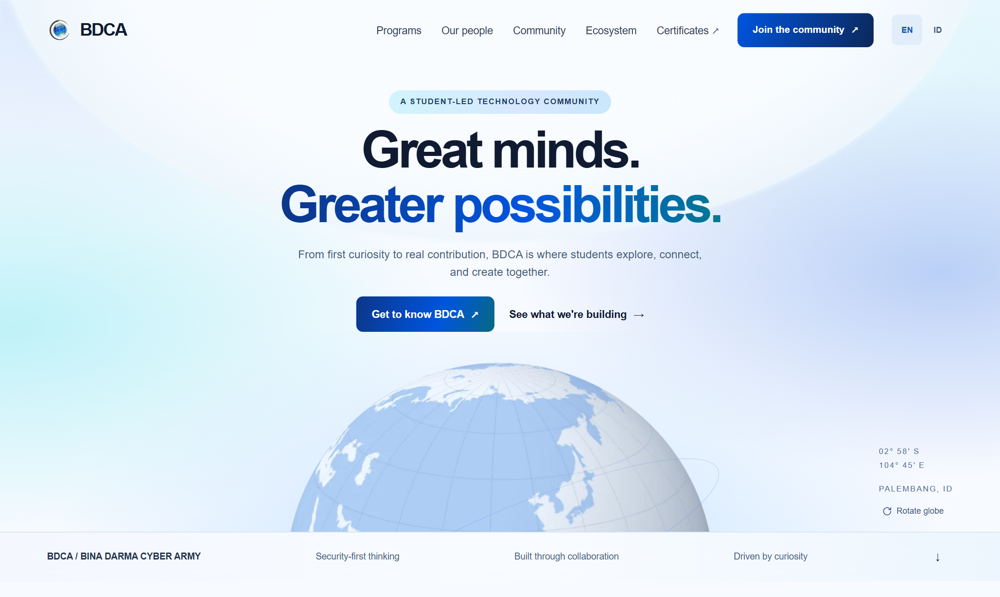
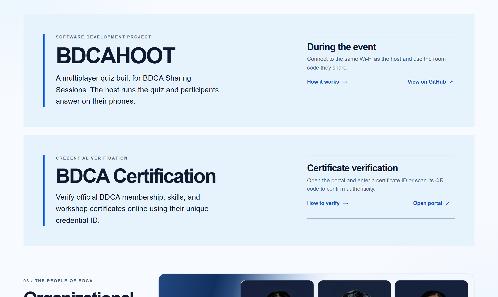
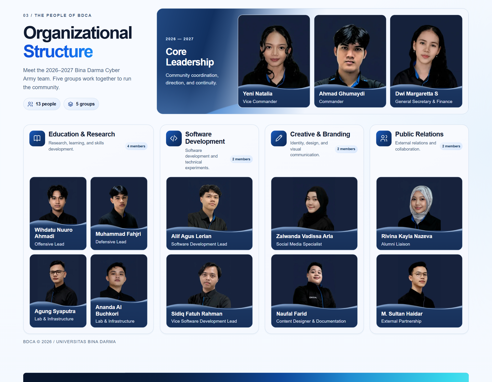
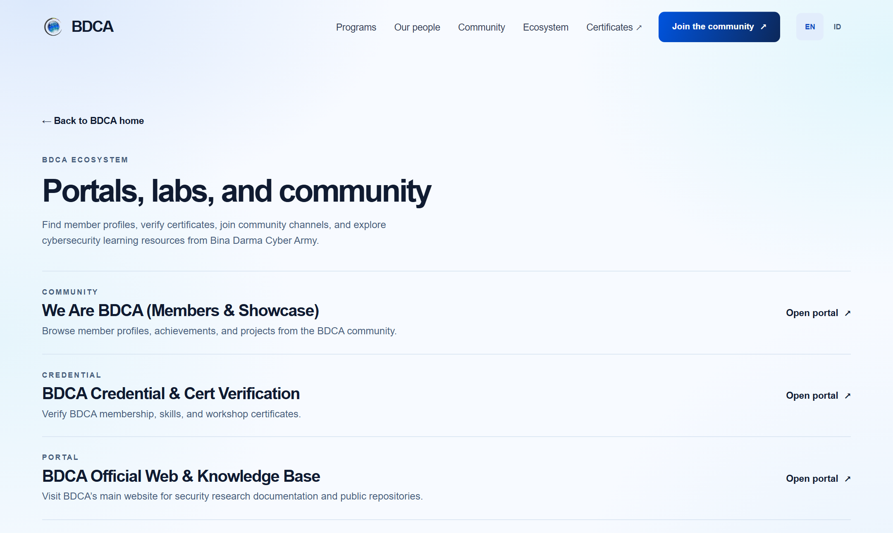
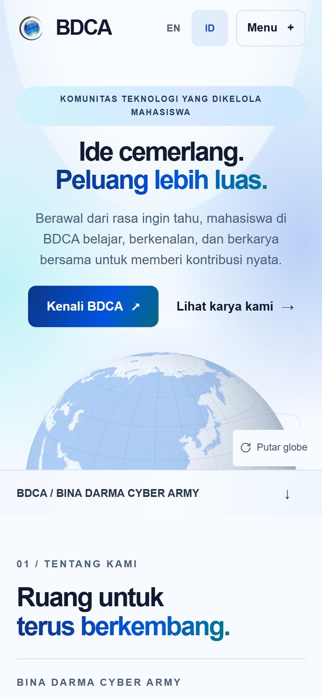

<div align="center">
  

  <h1>BDCA Landing Page &amp; Ecosystem Gateway</h1>

  <p>
    Official public website and ecosystem portal for <strong>Bina Darma Cyber Army (BDCA)</strong> — a student-led cybersecurity, software development, and research community at Universitas Bina Darma, Palembang, Indonesia.
  </p>

  <p>
    
    
    
    
    
  </p>

  <p>
    <a href="https://bidarcyberarmy.org">Main Site</a> ·
    <a href="https://cert.bidarcyberarmy.org/">Certification Portal</a> ·
    <a href="https://weare.bidarcyberarmy.org">We Are BDCA</a> ·
    <a href="https://github.com/bidarcyberarmy">GitHub</a> ·
    <a href="https://www.instagram.com/bidarcyberarmy/">Instagram</a>
  </p>
</div>

<br />

<p align="center">
  
</p>

---

## Highlights

- **Zero-framework static architecture:** Built with Astro and strict TypeScript, inlined CSS, system fonts, and zero runtime bloat.
- **Full bilingual support (`EN` / `ID`):** All pages are pre-rendered in English and Indonesian with canonical URLs, `hreflang` alternates, and JSON-LD structured data.
- **Progressive WebGL globe:** First paint renders a lightweight responsive WebP poster; the custom WebGL shader (Natural Earth 1:110m coastline texture) loads only on user interaction with automatic pause and context-loss fallback.
- **Featured community tools:** Dedicated showcase panels for **BDCAHOOT** (Sharing Session multiplayer quiz) and **BDCA Certification** (`cert.bidarcyberarmy.org`), plus direct navbar access.
- **2026–2027 organizational dashboard:** Five divisions and 13 members rendered with Astro `<Image>` responsive WebP portrait optimization.
- **Hardened security headers:** Strict Content Security Policy, HSTS, clickjacking protection, and immutable asset caching configured for Cloudflare Pages in `public/_headers`.

---

## Visual Preview

### Featured Projects & Portals

Showcases **BDCAHOOT** and **BDCA Certification** with expandable step-by-step guides and direct portal links.

<p align="center">
  
</p>

### Organizational Structure (2026–2027)

Responsive leadership and division dashboard with optimized WebP portraits and localized roles.

<p align="center">
  
</p>

### Ecosystem Portal & Mobile Bilingual View

<table>
  <tr>
    <td width="72%" valign="top">
      
      <p align="center"><sub><strong>Ecosystem Page (<code>/ecosystem/</code>)</strong> — Member directory, credential verification, CTFtime, VulnLab, and Discord</sub></p>
    </td>
    <td width="28%" valign="top">
      
      <p align="center"><sub><strong>Mobile View (<code>/id/</code>)</strong> — Indonesian locale with accessible <code>&lt;details&gt;</code> menu</sub></p>
    </td>
  </tr>
</table>

---

## Routes

| Route (English) | Route (Indonesian) | Content |
| --- | --- | --- |
| `/` | `/id/` | Hero, About, Programs, BDCAHOOT, BDCA Certification, 2026–2027 Team Structure, Community CTA |
| `/ecosystem/` | `/id/ecosystem/` | Member showcase, certification verification, knowledge base, CTFtime, VulnLab, and Discord |
| `/activities/` | `/id/activities/` | BDCA's national and international CTF competition record |

---

## Lighthouse Performance

Verified with **Lighthouse v13.5.0** across all 6 static routes on both **Mobile** and **Desktop** presets with `public/_headers` applied:

| Category | Mobile (All 6 Routes) | Desktop (All 6 Routes) |
| --- | :---: | :---: |
| **Performance** | **100** | **100** |
| **Accessibility** | **100** | **100** |
| **Best Practices** | **100** | **100** |
| **SEO** | **100** | **100** |

> Homepage Core Web Vitals: **LCP** `1.5 s` (mobile) / `0.4 s` (desktop) · **TBT** `0 ms` · **CLS** `0`. See [Lighthouse verification](docs/LIGHTHOUSE_OPTIMIZATION.md) for the full per-route breakdown.

---

## Project Structure

```text
.
├── docs/                   # Architecture, content, decisions, deployment & Lighthouse guides
│   └── images/             # README visual previews
├── public/
│   ├── _headers            # Cloudflare Pages CSP, HSTS & immutable cache rules
│   ├── robots.txt          # Crawl directives & sitemap reference
│   └── assets/             # Brand logos, hero/Palembang globe WebPs & placeholder silhouette
└── src/
    ├── assets/team/        # 4:5 WebP portrait sources optimized by Astro <Image>
    ├── components/         # Navbar, Home, Hero, About, Programs, Bdcahoot, Certificates, Structure, etc.
    ├── data/               # Typed bilingual copy, roster, ecosystem portals & achievements
    ├── layouts/            # Shared SEO, hreflang, Open Graph & JSON-LD layout
    ├── pages/              # Static catch-all route ([...path].astro)
    ├── scripts/            # Lazy-loaded WebGL globe renderer (globe.ts)
    └── styles/             # Design tokens & global styles (global.css)
```

---

## Local Development

Requires **Node.js `22.23.4+`** (`24.22.1` pinned in `.node-version`).

```sh
npm ci
npm run dev        # Start local dev server
npm run check      # Run Astro & TypeScript diagnostics
npm run build      # Build static production site to dist/
npm run preview    # Preview built output from dist/
```

> Note: `npm run preview` serves `dist/` locally but does not apply the Cloudflare Pages header rules in `public/_headers`.

---

## Documentation

| Guide | Description |
| --- | --- |
| [Architecture](docs/ARCHITECTURE.md) | Static bilingual routing, source map, and client-side behavior |
| [Content & Roster Management](docs/DATA_MANAGEMENT.md) | Updating team portraits, showcases, portals, and competition records |
| [Design & Implementation Decisions](docs/DECISIONS.md) | Cloud palette, WebGL strategy, accessibility, and SEO choices |
| [Cloudflare Pages Deployment](docs/DEPLOYMENT_GUIDE.md) | Build settings, Node.js version, domain sync, and post-deploy checks |
| [Lighthouse Verification](docs/LIGHTHOUSE_OPTIMIZATION.md) | Audit methodology, v13.5.0 benchmark scores, and Core Web Vitals |

---

<p align="center">
  Maintained by <strong>Bina Darma Cyber Army (BDCA)</strong> · Universitas Bina Darma, Palembang
</p>
